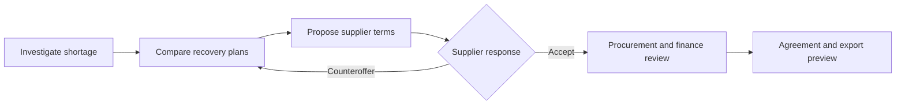

# Nodal Accord

**Collaborative supply resolution: from a supplier shortfall to an approved recovery plan.**

Nodal Accord connects supply-chain planning, supplier collaboration and commercial approval in one workbench. Buyers investigate disruptions, compare constrained recovery scenarios and negotiate with suppliers using validated plans. Procurement and finance teams retain approval authority, with a traceable record of the inputs and terms behind each decision.

[Website](https://nodal-accord.vercel.app/) · [Live demo](https://nodal-accord.vercel.app/app) · [API reference](https://nodal-accord-api.onrender.com/docs)

Independent working prototype using synthetic industrial supply-chain data. The hosted demo uses 500 suppliers; local datasets include up to 5,000. Allow about a minute for the hosted API to wake after inactivity.

## The resolution workflow



1. **Investigate.** Review the disruption, affected parts and plants, inventory, confirmed receipts and projected shortages.
2. **Simulate.** Compare the baseline with overtime, alternate sourcing, prebuild and hybrid options. Inspect service, cost and working-capital trade-offs.
3. **Negotiate.** Draft an offer from a validated scenario. The supplier can accept, reject or counteroffer; changes to quantities or delivery dates require a new simulation.
4. **Approve.** Procurement reviews the agreement. Finance approval also applies at the configured spending threshold or when payment terms change.
5. **Trace.** Inspect the agreed terms, scenario version, approval history and export preview.

## Core capabilities

### Constraint-aware planning

The Pyomo/HiGHS mixed-integer model accounts for shared machine capacity, supplier lead times, qualified sourcing lanes, lot sizes, inventory balances and locked releases. Its two-stage objective prioritises criticality-weighted late demand, then cost.

An independent validator reconstructs capacity and inventory balances from the original inputs before a plan becomes eligible for an offer. The workbench distinguishes proven optimal solutions from feasible plans with an outstanding solver gap.

Two scopes support different questions:

- **Case fixture:** an isolated disruption for a focused comparison and reference-solver validation.
- **12-week snapshot horizon:** a connected planning scope around a disruption, including lanes that share bottleneck resources.

### Commercial and workflow controls

- **Versioned terms:** immutable offer revisions, exact-version acceptance and SHA-256 term digests.
- **Current evidence:** input changes invalidate earlier scenarios, offers and approvals.
- **Separated responsibilities:** buyer planning, procurement, finance and supplier roles govern the workflow.
- **Financial context:** compare incremental buyer costs, inventory holding costs and illustrative payment-term financing effects.

### Scoped data access

Server-side tenant and organisation checks govern record access. Field-level projections separate buyer-confidential information from supplier-private economics, including when a supplier serves multiple buyers. Platform operators receive operational metadata rather than commercial records.

Illustrative ERP and supplier file connectors map external records into canonical fields, quarantine invalid rows with reason codes and reconcile accepted data against a read-only planning snapshot.

### Tool-using AI assistance

The optional DeepSeek assistant explains case evidence, compares solver results, requests a scenario run and drafts supplier message text. It uses the requesting user's scoped views, applies field redaction and records tool calls in the audit trail. Numerical statements without support in tool results receive an unverified flag.

People send offers, accept terms and approve agreements. The assistant supports investigation and preparation within those boundaries. The planning and collaboration workflow also runs without an AI provider.

## Architecture

| Layer | Implementation | Responsibility |
|---|---|---|
| Workbench | React, TypeScript, Vite, TanStack Query | Investigation, scenario comparison, supplier portal and approvals |
| API | FastAPI, Pydantic | Scoped access, workflow rules, imports and audit events |
| Planning and optimisation | Python, Pyomo, HiGHS | Inventory ledgers, constrained scenarios and independent validation |
| Execution | Separate optimisation worker | Asynchronous jobs with atomic claiming; API submission returns `202` |
| Data | Parquet snapshots; SQLite via SQLAlchemy | Read-only planning inputs and persistent workflow state |
| AI tools | Provider abstraction and bounded tool loop | Evidence-grounded assistance with server-side access controls |

The hosted frontend runs on Vercel and the API on Render. See the [architecture decisions](docs/architecture/decisions.md) and [mathematical formulation](docs/optimization/formulation.md) for implementation details.

## Run locally

### Prerequisites

- Python 3.12 or later.
- Node.js 18 or later, with npm.
- A generated synthetic dataset from the companion `Nodal_Accord_5000_Supplier_Data` project.

The dataset is a separate dependency, outside this repository. The default location is:

```text
../Nodal_Accord_5000_Supplier_Data/data/synthetic/generated/tiny/
```

Each dataset contains `tables/`, `scenarios/`, `golden/`, `access-tests/` and `external/`. To use another generated dataset, set `NODAL_DATA_ROOT` to its directory before starting the API and worker.

Run these commands from the repository root.

**Windows / PowerShell**

```powershell
.\scripts\bootstrap.ps1
npm run dev
```

**macOS / Linux**

```sh
sh scripts/bootstrap.sh
npm run dev
```

Open the workbench at **http://localhost:5173/app/** and the API documentation at **http://localhost:8000/docs**. The development command starts the API, worker and frontend, clearing ports 8000 and 5173 first. Stop the command with `Ctrl+C` when finished.

### Explore a complete case

Use the **Demo identity** selector to switch between roles:

| Identity | Role |
|---|---|
| `demo.buyer001.planner` | Investigate cases, run comparisons and draft offers |
| `demo.buyer001.procurement` | Send offers and review procurement approvals |
| `demo.buyer001.finance` | Review finance approvals |
| `demo.supplierNNNN.planner` | Review, accept or counter supplier offers |

With the default `tiny` dataset, open **CASE-000004**, run a **Case fixture** comparison and compare the shared-machine bottleneck across modes. Draft an offer, switch to procurement to send it, then to `demo.supplier0013.planner` to accept. Return to procurement to approve and inspect the export preview.

### Optional AI configuration

Set `DEEPSEEK_API_KEY` in the API process environment to enable the assistant. Public demos can also use `NODAL_AI_ACCESS_CODE` and `NODAL_AI_HOURLY_LIMIT` to control access and usage. See [`.env.example`](.env.example) for configuration names; keep credentials out of version control.

When enabled, the provider receives the question and the case data visible to the requesting user.

## Validation and evaluation

```sh
npm test
npm run build:web
```

The test suite covers planning balances, financial calculations, solver constraints, buyer-to-supplier workflows, stale approvals, tenant isolation, import validation and AI tool boundaries. AI tests use a scripted provider and require no paid API calls. Dataset-dependent tests skip when their inputs are unavailable.

The reference-solver tests compare **36 curated cases across five mitigation modes**, checking **180 case/mode outcomes** against the companion generator's independent solver. See the [cross-check tests](tests/unit/test_oracle_crosscheck.py) and [workflow tests](tests/e2e/test_buyer_supplier_case.py).

Recorded local benchmarks cover networks of **20, 500 and 5,000 synthetic suppliers**, including **30,000 sourcing lanes** in the largest dataset. Each solve handles a scoped disruption, rather than the entire network. Larger scopes can return feasible plans before proving optimality; the results retain status and gap information.

[Published evaluation data](docs/evaluation/) · [Scenario benchmark runner](tests/benchmark/solve_network.py) · [API benchmark runner](tests/benchmark/load_api.py)

## Prototype scope

The application demonstrates planning and collaboration with synthetic records, seeded demo identities and application-level access controls. Real ERP connectivity, production authentication and enterprise operational assurance remain outside the implemented scope. Agreement exports are previews; the application performs no ERP write-back or legal signing.

Nodal Accord is an independent project with no affiliation with SupplyOn or an ERP vendor. Benchmark results describe local synthetic workloads, not customer savings or production service guarantees.

## Author and licence

Created by [Mann D. Shah](https://github.com/mann13072) through AI-assisted development, with ownership of business requirements, planning logic, workflow design and validation.

Licensed under [Apache License 2.0](LICENSE). Third-party dependencies retain their respective licences.
